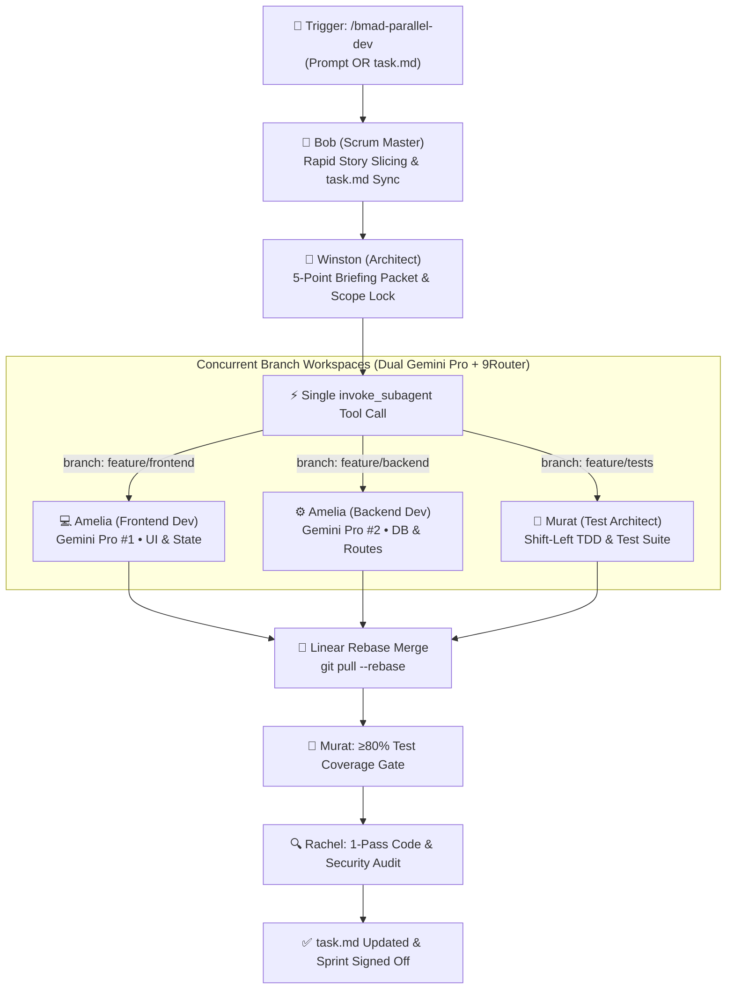

# BMAD Accelerated Parallel Development (`/bmad-parallel-dev`) ⚡

## Purpose
Accelerate delivery velocity by combining **multi-agent parallel execution** with **strict BMAD governance**. Decomposes features into decoupled streams (Frontend, Backend, and Tests) and executes them concurrently across isolated git branches (`Workspace: branch`) leveraging **9Router multi-account load balancing** and **dual Gemini Pro subscriptions**.

---

## Architecture & Concurrent BMAD Flow



---

## Operational Execution Protocol

### Step 1: Input Detection & Scope Boundary Lock 🔒
`/bmad-parallel-dev` supports two flexible input modes:
- **Mode A (Backlog-Driven)**: Reads existing uncompleted `[ ]` stories in `task.md`.
- **Mode B (Prompt-Driven)**: If invoked with an ad-hoc prompt (e.g. `/bmad-parallel-dev "Build Auth UI and API"`), **Bob (`bmad-sm`)** instantly logs the stories into `task.md` with Vibe Coding estimations (Dev, Test, Review time) before execution begins.

**Winston (`bmad-architect`)** locks the scope per `@scope-governance.md`:
1. **Explicit Touchpoint Declaration**:
   - `Frontend Stream`: e.g., `frontend/src/components/*`, `frontend/src/pages/*`
   - `Backend Stream`: e.g., `backend/app/routers/*`, `backend/app/models/*`
   - `Testing Stream`: e.g., `tests/unit/*`, `tests/integration/*`
2. **Interface Contract Pre-Lock**: Formulate REST/GraphQL schemas, DTOs, and error codes so Amelia-UI and Amelia-API can work in complete isolation without merge collisions.

---

### Step 2: Formulate 5-Point Briefing Packets
Per `@team-collaboration-protocol.md`, construct an unambiguous Briefing Packet for each parallel branch:

1. **Target Goal**: Exact component or endpoint story.
2. **Touchpoint Files**: Strictly declared files (`[CREATE]`, `[MODIFY]`).
3. **Interface Signatures**: Exact function signatures, DTOs, or route definitions.
4. **Boundary Constraints & Security**: Auth middleware, validation, zero-leak logging.
5. **Deterministic Verification Command**: Exact CLI test command (e.g., `pytest tests/test_auth.py` or `npm test`).

---

### Step 3: Single-Turn Concurrent Subagent Spawning ⚡
Execute a single `invoke_subagent` tool call containing all streams concurrently. Antigravity runs them in parallel background tasks:

```json
{
  "Subagents": [
    {
      "TypeName": "bmad-dev",
      "Role": "Amelia (Frontend Specialist)",
      "Model": "pro",
      "Workspace": "branch",
      "Prompt": "Briefing Packet: Frontend Component for Story [ID]. Touchpoints: [Files]. Contract: [Schema]. Verification: npm test [File]"
    },
    {
      "TypeName": "bmad-dev",
      "Role": "Amelia (Backend Specialist)",
      "Model": "pro",
      "Workspace": "branch",
      "Prompt": "Briefing Packet: Backend API for Story [ID]. Touchpoints: [Files]. Contract: [Schema]. Verification: pytest [File]"
    },
    {
      "TypeName": "bmad-tester",
      "Role": "Murat (Test Architect)",
      "Model": "flash",
      "Workspace": "branch",
      "Prompt": "Briefing Packet: Unit test suite for Story [ID]. Implement edge cases and mock fixtures. Verification: pytest -v"
    }
  ]
}
```

> [!TIP]
> **9Router Optimization**: The concurrent requests are automatically intercepted by local 9Router (`http://127.0.0.1:20128`), distributing load between **Gemini Pro Account #1** and **Gemini Pro Account #2** with 20–40% token compression via RTK.

---

### Step 4: Deterministic Branch Integration
Once background notifications confirm subagents have completed:
1. Review the ≤15-line Executive Summary from each branch.
2. Integrate branches using linear git rebase (`git pull --rebase`) per `@git-workflow.md`.
3. Check for any quarantined technical debt logged by the developers.

---

### Step 5: BMAD Quality Gates & Single-Pass Review 🛡️
1. **Murat (`bmad-tester`)**: Executes the unified test suite to verify the **≥80% code coverage gate**.
2. **Rachel (`bmad-reviewer`)**: Conducts a single-pass PR diff inspection across `[SEC]`, `[ARCH]`, `[PERF]`, and `[SCOPE]`.
3. **Bob (`bmad-sm`)**: Marks all completed items `[x]` in `task.md` and records actual delivery time.
