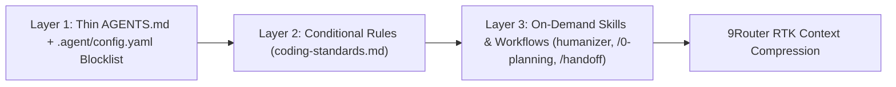

# Token-Optimized Skills & Conventions Integration — Implementation Plan

- **GitHub Issue**: [#26](https://github.com/wayangalihpratama/my-antigravity-pilot/issues/26)
- **Target Branch**: `feature/26-token-optimized-skills`
- **Status**: Approved — Phase 1 Research Complete

---

## Overview

Integrate high-ROI engineering patterns from four external agent repositories into `bmad-team/` with zero prompt bloat and net-negative per-turn token overhead:

1. **Ponytail (`DietrichGebert/ponytail`)**: 7-step Lazy Senior Dev Decision Ladder + `[BLOAT]` review severity tag.
2. **Humanizer (`blader/humanizer`)**: Compact, on-demand anti-AI-prose skill for docs and PRs.
3. **Matt Pocock Skills (`mattpocock/skills`)**: Domain Glossary alignment + Decision-Tree ambiguity check in planning, plus `/handoff` session compaction.
4. **Omarchy Overlay (`zuhdil/omarchy-overlay`) & Token Hygiene**: Thin 3-layer pointer index across `AGENTS.md` / `CLAUDE.md` and expanded `skills.blocklist` in `CONFIG.yaml`.

---

## Requirements Discovery (5W1H)

| Dimension | Definition |
| :--- | :--- |
| **Who** | BMAD v6 personas (`bmad-dev`, `bmad-reviewer`, `bmad-writer`, `bmad-pm`, `bmad-sm`) and developers using Antigravity, Claude Code, or Codex. |
| **What** | Surgical addition of pre-code minimalism gates, anti-AI-prose checks, planning ambiguity/glossary checks, session handoff compaction, and active skill pruning. |
| **Where** | `bmad-team/rules/`, `bmad-team/skills/`, `bmad-team/workflows/`, `bmad-team/templates/CONFIG.yaml`, root `AGENTS.md` / `CLAUDE.md`, and `.agent/config.yaml`. |
| **When** | Conditional loading (`model_decision` or explicit invocation) for rules/skills/workflows; every-turn skill pruning via `.agent/config.yaml`. |
| **Why** | Prevent LLM premature abstraction (`[BLOAT]`), eliminate AI-slop prose in docs/PRs, remove planning drift, and cut ~2,000+ wasted system-prompt tokens/turn. |
| **How** | Localized edits in canonical `bmad-team/` assets, validated via frontmatter/budget checks and propagated via `./setup.sh --sync-all`. |

---

## Architecture Overview

A 3-layer context loading architecture ensures base turns stay lean while specialized behaviors load strictly on demand:

1. **Layer 1 — Always-On Hygiene**: Thin root `AGENTS.md` / `CLAUDE.md` pointer indexes + `.agent/config.yaml` `skills.blocklist` pruning unrelated scientific/GCP/mobile plugin skills.
2. **Layer 2 — Conditional Rules**: `bmad-team/rules/coding-standards.md` (`trigger: model_decision`) enforces the 7-step Ponytail Decision Ladder only during code design/implementation.
3. **Layer 3 — On-Demand Skills & Workflows**: `humanizer`, `/0-planning`, `/handoff`, and `bmad-reviewer` load only when explicitly invoked, then pass through 9Router RTK compression.

---

## 1. Component Specifications (Agent Framework Repo)

### 1.1 Touchpoint Matrix & Budgets

| Action | File (Project-Root-Relative) | Trigger / Mode | Line Budget / Contract |
| :--- | :--- | :--- | :--- |
| `[MODIFY]` | `bmad-team/rules/coding-standards.md` | `trigger: model_decision` | Add ≤ 15 lines: 7-step Ponytail Decision Ladder (`Skip -> Reuse -> Stdlib -> Native Platform -> Existing Dep -> 1-Liner -> Minimal Code`) + mandatory check item. |
| `[MODIFY]` | `bmad-team/skills/bmad-reviewer/SKILL.md` | On-demand skill | Add `[BLOAT]` severity tag (unnecessary abstraction, single-use interface, or avoidable new dependency). |
| `[MODIFY]` | `bmad-team/subagents/bmad-reviewer.md` | Subagent persona | Sync `[BLOAT]` severity tag with `bmad-reviewer/SKILL.md`. |
| `[MODIFY]` | `bmad-team/workflows/bmad-review.md` | On-demand workflow | Sync `[BLOAT]` severity category with `bmad-reviewer/SKILL.md`. |
| `[CREATE]` | `bmad-team/skills/humanizer/SKILL.md` | On-demand skill (`name: humanizer`) | ≤ 60 lines: compact checklist of top Wikipedia AI-writing tells (triads, "not X but Y", em-dash overuse, puffery/buzzwords, filler transitions). |
| `[MODIFY]` | `bmad-team/skills/bmad-writer/SKILL.md` | On-demand skill | Reference `@humanizer` for READMEs, user guides, and PR descriptions. |
| `[MODIFY]` | `bmad-team/subagents/bmad-writer.md` | Subagent persona | Sync `@humanizer` anti-AI-prose principle with `bmad-writer/SKILL.md`. |
| `[MODIFY]` | `bmad-team/workflows/6-pr.md` | On-demand workflow | Add 1-line `@humanizer` prose check before PR body output. |
| `[MODIFY]` | `bmad-team/workflows/0-planning.md` | On-demand workflow | Add Domain Glossary alignment + Decision-Tree ambiguity check (≤ 10 lines). |
| `[CREATE]` | `bmad-team/workflows/handoff.md` | On-demand workflow (`/handoff`) | ≤ 45 lines: emits ≤ 25-line session state checkpoint (goal, branch/files, verified state, next command) for clean context resets. |
| `[MODIFY]` | `bmad-team/templates/CONFIG.yaml` | Static config template | Expand `skills.blocklist` with unused heavy domain plugin patterns (`chembl-*`, `cheminformatics-*`, `clinvar-*`, `dbsnp-*`, `embl-*`, `encode-*`, `ensembl-*`, `foldseek-*`, `gnomad-*`, `gtex-*`, `human-protein-*`, `interpro-*`, `jaspar-*`, `ncbi-*`, `openfda-*`, `opentargets-*`, `pdb-*`, `predictingthepast`, `pubchem-*`, `pubmed-*`, `quickgo-*`, `rdkit-*`, `reactome-*`, `science-*`, `string-*`, `ucsc-*`, `unibind-*`, `uniprot-*`, `biomolecular-*`). |
| `[CREATE]` | `.agent/config.yaml` | Local workspace config | Synced from `bmad-team/templates/CONFIG.yaml` for active token pruning in the pilot workspace. |
| `[MODIFY]` | `AGENTS.md`, `CLAUDE.md`, `README.md` | Always-on root index & docs | Trim duplicated rule prose; keep thin pointer index + document `/handoff`, `humanizer`, and `[BLOAT]`. |
| `[CREATE]` | `bmad-team/scripts/validate-bmad-assets.py`, `tests/test_validate_bmad_assets.py` | Pure Python 3 stdlib CLI & `unittest` | Zero-dep validator & TDD test suite checking YAML frontmatter, `CONFIG.yaml` structure, line budgets, cross-references, and Rule #6 path-leak scans. |

### 1.2 Explicit Out-of-Scope & Quarantine Boundaries

- **Do NOT** install `mattpocock/skills` in bulk (no duplicate `/tdd`, `/write-a-prd`, `/code-review`, or `/to-tickets`).
- **Do NOT** import Arch Linux, Hyprland, `mise`, or Bash OS overlay rules from `zuhdil/omarchy-overlay`.
- **Do NOT** manually edit application code or stack-specific files outside `.agent/` sync targets; propagation to stack directories must use `./setup.sh --sync-all`.

---

## 2. Verification & Testing

### 2.1 Automated Checks
- **YAML Frontmatter & Line Budgets**:
  - Verify `name` and `description` YAML frontmatter on `bmad-team/skills/humanizer/SKILL.md` and `description` on `bmad-team/workflows/handoff.md`.
  - Assert `wc -l` budgets: `humanizer/SKILL.md` ≤ 60 lines; `handoff.md` ≤ 45 lines.
- **Rule #6 Path Leak Scan**:
  - `grep -rnE "/(Users|home)/" bmad-team/ docs/features/ AGENTS.md CLAUDE.md` (must return 0 matches).
- **Sync Dry-Run**:
  - `./setup.sh --sync-all --dry-run` (must exit 0 with expected updates and zero errors).

### 2.2 Manual Verification Steps
1. Inspect `git diff` against the Touchpoint Matrix to confirm zero out-of-scope edits (`[SCOPE]` gate).
2. Run `python3 -m unittest discover -s tests -p "test_*.py" -v && python3 bmad-team/scripts/validate-bmad-assets.py` to validate YAML frontmatter, `CONFIG.yaml` structure, line budgets, and path-leak checks without requiring external `PyYAML`.

---

## 3. Epic & Vibe Coding Estimation ⏱️

> Estimates follow the 3-part Vibe Coding breakdown: **Vibe Coding (Dev)** + **Automated Testing** + **QA & Review** = **Total Est. Time**.
> - Confidence Level: High
> - Dependencies: Issue [#26](https://github.com/wayangalihpratama/my-antigravity-pilot/issues/26)

| Task ID | Component & Description | Vibe Coding (Dev) | Automated Testing | QA & Review | Total Est. Time | Priority |
| :--- | :--- | :---: | :---: | :---: | :---: | :--- |
| **T-001** | Ponytail Decision Ladder (`coding-standards.md`) & `[BLOAT]` tag (`bmad-reviewer`) | 15m | 10m | 10m | **35m (0.6h)** | Must Have |
| **T-002** | Compact `humanizer` skill + `bmad-writer` / `6-pr.md` wiring | 20m | 10m | 10m | **40m (0.7h)** | Must Have |
| **T-003** | Planning Glossary/Ambiguity check (`0-planning.md`) & `/handoff` workflow | 20m | 10m | 10m | **40m (0.7h)** | Must Have |
| **T-004** | Token pruning (`CONFIG.yaml`, `.agent/config.yaml`) & thin `AGENTS.md`/`CLAUDE.md` | 20m | 10m | 10m | **40m (0.7h)** | Must Have |
| **T-005** | Pure-stdlib asset validator (`validate-bmad-assets.py`, `tests/`), `./setup.sh --sync-all`, & root `.agent/`/`.claude/` sync | 15m | 15m | 15m | **45m (0.8h)** | Must Have |

---

## 4. Technical Audit (Phase 1 Research)

1. **Root Workspace Sync Gap in `setup.sh --sync-all`**:
   - `setup.sh` skips `.` and `./bmad-team` during `--sync-all`, so it updates the 8 stack `.agent/` directories (`business-landing/`, `fastapi-ai-stack/`, `fastapi-nextjs/`, `fastapi-react/`, `laravel/`, `python-streamlit/`, `retro-game/`, `strapi-nextjs/`) without updating root `.agent/` or `.claude/skills/`.
   - **Action in `T-005`**: Run `./setup.sh --sync-all` for stack targets, then explicitly sync updated/created assets into root `.agent/`, copy `bmad-team/templates/CONFIG.yaml` to `.agent/config.yaml`, and symlink `.claude/skills/humanizer -> ../../bmad-team/skills/humanizer` (all gitignored per `.gitignore`).
2. **Subagent Prompt Alignment (`bmad-team/subagents/`)**:
   - `bmad-team/subagents/bmad-reviewer.md` and `bmad-team/subagents/bmad-writer.md` duplicate severity tags and persona principles from `bmad-team/skills/`. Both are added to `T-001` and `T-002` so subagent invocations stay consistent.
3. **Non-Destructive Stack `AGENTS.md` / `CLAUDE.md` Behavior**:
   - `setup.sh` (`setup_claude_codex`) preserves pre-existing `AGENTS.md` and `CLAUDE.md` in stack directories. All 8 stacks already track their own copies in git. Per Scope Governance, `T-004` updates only root `AGENTS.md` and root `CLAUDE.md`; stack copies remain out-of-scope.
4. **Zero-Dependency Validation Tooling**:
   - System `python3` lacks `PyYAML` (`yaml` module), and Ruby gem specs are blocked by sandbox permissions. `T-005` uses a zero-dependency Python 3 standard-library validator (`bmad-team/scripts/validate-bmad-assets.py`) + `unittest` suite (`tests/test_validate_bmad_assets.py`) with no external dependencies.
